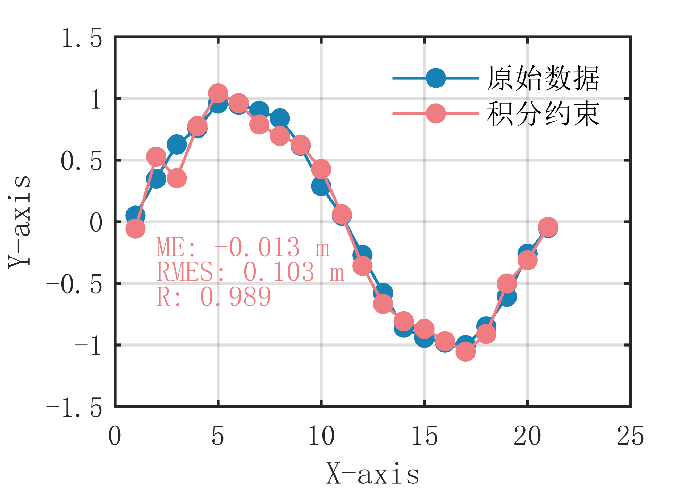

# MATLAB | Data Fitting Algorithms | Polynomial Fitting Algorithm with Integral Constraints | Included data and plotting code | Directly Useable

1. Basic Definition: The polynomial fitting algorithm with integral constraints adds a smoothness constraint to the polynomial fitting, resulting in a more smooth fitting curve to achieve better fitting effects. The main idea of this algorithm is to add an integral term in the polynomial coefficients, so that the fitting curve satisfies the smoothness constraints to some extent. Specifically, the steps of the polynomial fitting algorithm with integral constraints are as follows:

Given a set of data points {(x1, y1), (x2, y2), ..., (xn, yn)}.
Assuming the fitting curve is y = f(x), where f(x) is an nth-degree polynomial.
Add an integral term in the polynomial coefficients to get a new objective function: ∑(yi - f(xi))^2 + λ∫(f''(x))^2dx, where f''(x) is the second derivative of the fitting curve, λ is a smoothness parameter to adjust the smoothness of the fitting curve, and ∑ denotes the summation.
Solving for n+1 unknown coefficients a0, a1, ..., an such that the objective function is minimized. The advantage of this polynomial fitting algorithm with integral constraints is that it can satisfy the smoothness constraints to some extent, preserve the overall trend of the data, and also has good fitting effects for some data with obvious curvature. However, it requires selecting an appropriate smoothness parameter to achieve optimal fitting results. Additionally, this algorithm may have a significant impact on the fitting results for some data with extreme values.

2. Definition and plot effect:
The plot effect is as follows:
\n        \n          \n          \n          \n          \n            To view this video please enable JavaScript, and consider upgrading to a\n            web browser that\n            supports HTML5 video\n  

## Images

<!-- PAYMENT_BLOCK -->

## Get this dataset

- Payment link (Stripe): [Buy now](https://buy.stripe.com/3cs8yP7sY87d0vu9AB)
- Payment QR code: 

<!-- /PAYMENT_BLOCK -->
